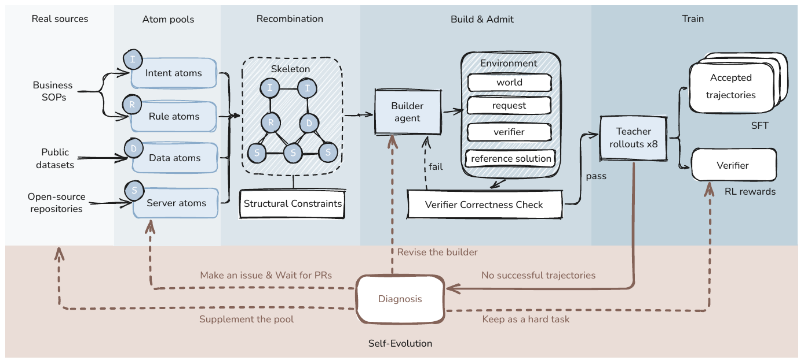

# LegoEnv: Self-Evolving Agentic Environments via Modular Recombination

[](https://github.com/JazyJiang/LegoEnv)
[](https://arxiv.org/abs/2611.01834v1)
[](https://huggingface.co/JazySong/LegoEnv)
[](https://huggingface.co/datasets/JazySong/LegoEnv)
[](LICENSE)

LegoEnv builds training environments for tool-using agents by composing them
from reusable atoms: **server** atoms (an app's entities and tools), **data**
atoms (seed rows from real public datasets), **intent** atoms (what the user
wants done) and **rule** atoms (business policies the agent must find and
apply). Workflow skeletons are recombined under structural constraints, and a
builder agent turns each skeleton into an executable world with a goal, a
programmatic verifier and a reference solution. Every environment is checked
(reference replay, verifier sanity, observation limits) before teacher rollouts
are collected. When rollouts fail, the failure is diagnosed and fixed at the
shared atom, so the repair carries over to every environment built from it.

<p align="center"></p>

## Layout

| Path | Contents |
|---|---|
| `legoenv/runtime/` | Deterministic environment runtime: state, tool execution, guards and verifiers (`runtime.py`, `grammar.py`), MCP server (`mcp_server.py`) |
| `legoenv/apps/` | Server atoms: 212 app specs (`base_specs/`), per-app adapters with capability cards (`adapters/<app>/`), app index (`APPS.md`) |
| `legoenv/atoms/` | Everything that produces an atom pool, one directory per family ([provenance map](legoenv/atoms/README.md)): `server/` (the two-stage compiler in `compiler/stage1_collect/` and `compiler/stage2_spec/`, its prompts, and app onboarding; see [`docs/compiler.md`](legoenv/docs/compiler.md)), `data/` (dataset-mining prompts and dataset cards), `workflow/` (the web-mining brief and driver for intent and rule atoms; see [`docs/skeleton_mining.md`](legoenv/docs/skeleton_mining.md)) |
| `legoenv/skeleton/` | Composition contract: skeleton schema, vocabulary, validator, recombination, capability-card schema and the onboarding check |
| `legoenv/builder/` | Builder library (`packlib.py`, `dklib.py`, acceptance and emission), builder skill (`SKILL.md`), world-merge helpers (`compose/`), task batches, two reference packs (`examples/`) and the runtime revision the builder admits environments with (`legacy_runtime/`) |
| `legoenv/prompts/` | Builder prompt (`BUILDER.md`) and failure-diagnosis prompt (`AGENT_BRIEF.md`) with their hashes |
| `legoenv/sampling/` | API-style endpoint catalog used for teacher rollouts (`apistyle.py`) and the teacher's rollout prompt (`prompts/`) |
| `legoenv/tools/` | Command-line entrypoints: `pipeline.py` (build, verify, sample), native builder, checks |
| `legoenv/training/` | Trainer-independent training interfaces: trajectory export to SFT JSONL (`sft/tools/`), the RL environment interface and prompt builder (`rl/`), and the recorded SFT and GRPO settings (`HYPERPARAMETERS.md`); no trainer is included |
| `legoenv/docs/` | Installation, model API, runtime/training, RL and app-integration details |
| `legoenv/provenance/` | File manifest checked by `tools/release_check.py` |
| `bridge/` | Claude Code to OpenAI Chat Completions protocol bridge and pinned Claude Code installer |
| `third_party_licenses/` | Upstream license texts for apps, datasets and adapted code |

## Quick start

Python 3.12 or later. These checks run on CPU, use only the standard library
and make no model requests.

```bash
cd legoenv
python -B tools/preflight.py --mode runtime
python -B tools/test_openai_bridge.py
python -B tools/release_check.py
```

Build a two-record demo environment and replay its reference solution against
the verifier:

```bash
python tools/pipeline.py build-demo --out /tmp/legoenv-demo
python tools/pipeline.py verify --task /tmp/legoenv-demo/demo.task.json \
                                --spec /tmp/legoenv-demo/demo.spec.json
```

`verify` checks that the verifier is false on the seed state, true after the
reference solution and false again after a reset.

## Build an environment from a skeleton

A skeleton names the apps, deliverable and rule atoms, and counts for one
workflow (schema: `legoenv/skeleton/skeleton_schema.json`, contract:
`legoenv/atoms/workflow/CONTRACT.md`). Skeletons are mined from public workflow pages
with `atoms/workflow/mine.sh` and recombined with `skeleton/skel4_recombine.py`
([details](legoenv/docs/skeleton_mining.md)).

Validate a skeleton and render the builder prompt for it (no model call):

```bash
python tools/pipeline.py render-builder --skeleton /path/to/skeleton.json \
  --contract skeleton --base-specs apps/base_specs --out /tmp/builder-prompt.md
```

Run the builder agent (Claude Code 2.1.186, see [`bridge/`](bridge/README.md))
in an isolated Linux namespace against an OpenAI-compatible endpoint. Run once
with `--cpu-probe` to check isolation and dependencies, then without it:

```bash
export OPENAI_BASE_URL=https://provider.example/v1 OPENAI_MODEL=your-model OPENAI_API_KEY=...
python tools/pipeline.py build-native \
  --data /path/to/data-root --inventory /path/to/DATA_INVENTORY.md \
  --skeleton /path/to/skeleton.json --out /path/to/new-build \
  --python-root /path/to/python312 --data-deps /path/to/data-deps \
  --claude /path/to/claude --namespace-mode user
```

`--data` must contain `datapool/` with the seed datasets. Admitted environments
are listed in `packs.tsv` and recorded in `RESULT.json`. The builder workspace
is assembled from the repository by `tools/builder_workspace.py`. See
[installation](legoenv/docs/installation.md) and
[model configuration](legoenv/docs/openai_api.md).

## Collect a trajectory

Roll out a teacher model on built environments. The pack list has four
tab-separated columns: pack set, task JSON, spec JSON, notes file or `-`.

```bash
python tools/pipeline.py sample --packs /tmp/legoenv-demo/packs.tsv --out /tmp/episodes \
  --base-url https://provider.example/v1 --model your-teacher --samples 8 --dry-run
```

Remove `--dry-run` to send requests. Export verifier-passing episodes for SFT:

```bash
python training/sft/tools/episodes_to_jsonl.py /tmp/episodes -o /tmp/sft.jsonl \
  --filter complete_verifier_pass --check-tool-names
```

## Train

LegoEnv ships the environments and training data, not a trainer.

- SFT: export trajectories with `training/sft/tools/episodes_to_jsonl.py` (above) and
  train with any chat-template SFT stack.
- RL: serve environments to your RL loop with `legoenv/training/rl/rl_env/`
  (env host, tool-call parsing, verifier reward); build prompts from packs with
  `legoenv/training/rl/build_prompts.py`.
- Settings of the reported SFT and GRPO runs:
  [`legoenv/training/HYPERPARAMETERS.md`](legoenv/training/HYPERPARAMETERS.md).

Details: [runtime and training](legoenv/docs/runtime_and_training.md),
[RL](legoenv/docs/rl.md), [models](legoenv/docs/models.md),
[server-atom compiler](legoenv/docs/compiler.md),
[skeleton mining](legoenv/docs/skeleton_mining.md).

## Data and models

Model checkpoints are published at
[`JazySong/LegoEnv`](https://huggingface.co/JazySong/LegoEnv) (see
[`legoenv/docs/models.md`](legoenv/docs/models.md)). Environments, trajectories,
atom pools and rebuild recipes are published as the dataset
[`JazySong/LegoEnv`](https://huggingface.co/datasets/JazySong/LegoEnv).

## License

First-party code is licensed under [Apache-2.0](LICENSE). First-party data is
released under CC BY 4.0. Third-party apps, datasets and adapted code keep
their own licenses; see [THIRD_PARTY_NOTICES.md](THIRD_PARTY_NOTICES.md) and
[`third_party_licenses/`](third_party_licenses/). Qwen weights keep their base
model license.

## Citation

```bibtex
@article{jiang2026legoenv,
  title   = {LegoEnv: Self-Evolving Agentic Environments via Modular Recombination},
  author  = {Jiang, Zhuosong and Wu, Chengxu and Liu, Junqi and Yi, Yujie and Wang, Siqin and
             Huang, Zhixuan and Jiang, Jinqian and Xiao, Lijun and Li, Jianxun and Pan, Yongyang and
             Wang, Jieran and Shen, Shiqi and Liu, Fei and Lin, Xinyu},
  journal = {arXiv preprint arXiv:2611.01834},
  year    = {2026}
}
```

See also [`CITATION.cff`](CITATION.cff).
